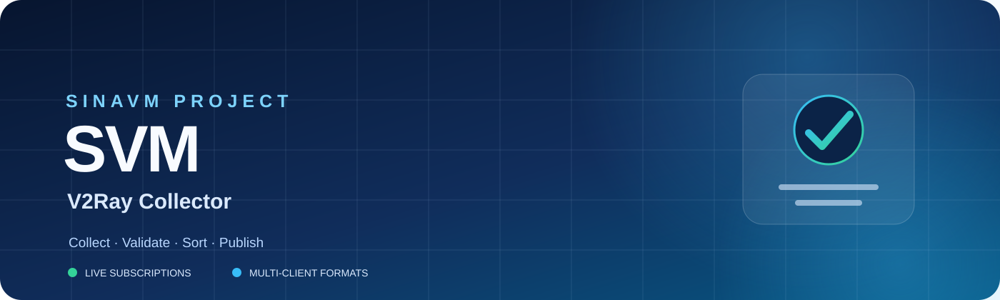
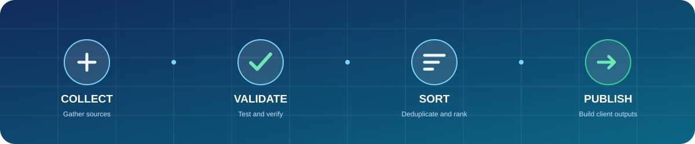

<h2>SiNAVM | Free Configuration Collection</h2>

 
 

---

## 🚀 شروع سریع

اگر فقط یک لینک لازم دارید، یکی از اشتراک‌های زیر را انتخاب کنید:

| اشتراک | مناسب برای | دریافت |
|:--|:--|:--|
| ⚡ **لایت سریع** | فهرست کوچک‌تر با اولویت سرعت | [دریافت اشتراک](https://raw.githubusercontent.com/sinavm/SVM/main/lite/subscriptions/xray/normal/alive-fast) |
| 🧩 **لایت پایدار** | فهرست جمع‌وجورتر با اولویت پایداری | [دریافت اشتراک](https://raw.githubusercontent.com/sinavm/SVM/main/lite/subscriptions/xray/normal/alive-stable) |
| 🌐 **مجموعه کامل** | همه نودهای خروجی پروژه | [دریافت اشتراک](https://raw.githubusercontent.com/sinavm/SVM/main/subscriptions/xray/normal/mix) |

لینک را کپی کنید و در بخش افزودن Subscription کلاینت خود وارد کنید. خروجی‌ها علاوه بر منابع اصلی، ساب‌لینک‌های تعریف‌شده در پروژه را نیز در فرآیند تجمیع پوشش می‌دهند. برای انتخاب فرمت مناسب و دریافت QR، [داشبورد SVM](https://sinavm.github.io/SVM/) را باز کنید.

## 📊 وضعیت زنده پروژه

وضعیت و خروجی‌های پروژه را از منابع اصلی و گزارش‌های منتشرشده دنبال کنید:

## 📦 اشتراک‌ها بر اساس کلاینت

همه لینک‌ها به خروجی‌های فعلی پروژه اشاره می‌کنند.

| کلاینت | اشتراک کامل | فرمت |
|:--|:--|:--|
| **Sing-box** | [دریافت mix.json](https://raw.githubusercontent.com/sinavm/SVM/main/subscriptions/singbox/mix.json) | JSON |
| **Xray** | [دریافت mix](https://raw.githubusercontent.com/sinavm/SVM/main/subscriptions/xray/normal/mix) | Normal |
| **Xray Base64** | [دریافت mix](https://raw.githubusercontent.com/sinavm/SVM/main/subscriptions/xray/base64/mix) | Base64 |
| **Clash** | [دریافت mix](https://raw.githubusercontent.com/sinavm/SVM/main/subscriptions/clash/mix) | YAML |
| **Clash Meta** | [دریافت mix](https://raw.githubusercontent.com/sinavm/SVM/main/subscriptions/meta/mix) | YAML |
| **Surfboard** | [دریافت mix](https://raw.githubusercontent.com/sinavm/SVM/main/subscriptions/surfboard/mix) | YAML |

## 🧭 اشتراک‌ها بر اساس پروتکل

| پروتکل | Sing-box | Xray | Clash Meta |
|:--|:--|:--|:--|
| VLESS | [JSON](https://raw.githubusercontent.com/sinavm/SVM/main/subscriptions/singbox/vless.json) | [Normal](https://raw.githubusercontent.com/sinavm/SVM/main/subscriptions/xray/normal/vless) | [Meta](https://raw.githubusercontent.com/sinavm/SVM/main/subscriptions/meta/vless) |
| VMess | [JSON](https://raw.githubusercontent.com/sinavm/SVM/main/subscriptions/singbox/vmess.json) | [Normal](https://raw.githubusercontent.com/sinavm/SVM/main/subscriptions/xray/normal/vmess) | [Meta](https://raw.githubusercontent.com/sinavm/SVM/main/subscriptions/meta/vmess) |
| Trojan | [JSON](https://raw.githubusercontent.com/sinavm/SVM/main/subscriptions/singbox/trojan.json) | [Normal](https://raw.githubusercontent.com/sinavm/SVM/main/subscriptions/xray/normal/trojan) | [Meta](https://raw.githubusercontent.com/sinavm/SVM/main/subscriptions/meta/trojan) |
| Shadowsocks | [JSON](https://raw.githubusercontent.com/sinavm/SVM/main/subscriptions/singbox/ss.json) | [Normal](https://raw.githubusercontent.com/sinavm/SVM/main/subscriptions/xray/normal/ss) | [Meta](https://raw.githubusercontent.com/sinavm/SVM/main/subscriptions/meta/ss) |
| Hysteria2 | [JSON](https://raw.githubusercontent.com/sinavm/SVM/main/subscriptions/singbox/hy2.json) | [Normal](https://raw.githubusercontent.com/sinavm/SVM/main/subscriptions/xray/normal/hy2) | [Meta](https://raw.githubusercontent.com/sinavm/SVM/main/subscriptions/meta/hy2) |
| TUIC | [JSON](https://raw.githubusercontent.com/sinavm/SVM/main/subscriptions/singbox/tuic.json) | [Normal](https://raw.githubusercontent.com/sinavm/SVM/main/subscriptions/xray/normal/tuic) | [Meta](https://raw.githubusercontent.com/sinavm/SVM/main/subscriptions/meta/tuic) |
| Reality | [JSON](https://raw.githubusercontent.com/sinavm/SVM/main/subscriptions/singbox/reality.json) | [Normal](https://raw.githubusercontent.com/sinavm/SVM/main/subscriptions/xray/normal/reality) | [Meta](https://raw.githubusercontent.com/sinavm/SVM/main/subscriptions/meta/reality) |

## 📱 دریافت با QR

برای باز کردن داشبورد و انتخاب اشتراک از موبایل، QR زیر را اسکن کنید:

## ⚙️ چرخه به‌روزرسانی

## 💛 حمایت اختیاری از پروژه

هیچ بخشی از SVM پولی نیست و تمام اشتراک‌ها و امکانات پروژه بدون پرداخت در دسترس هستند. اگر این پروژه برایتان مفید بوده و مایلید در هزینه نگهداری و توسعه آن سهیم شوید، می‌توانید هر مبلغ دلخواهی را به یکی از آدرس‌های زیر ارسال کنید. حمایت کاملاً اختیاری است و حتی یک مبلغ کوچک هم ارزشمند است.

### ₿ بیت‌کوین · Bitcoin

**شبکه:** Bitcoin

`bc1qa6rsvv9dl24tdu4w28rptu96jak0rtwv5qnx58`

---

### ◈ آدرس مشترک شبکه‌های EVM · ETH / USDT

**برای دریافت ETH:** شبکه Ethereum · ERC20

**برای دریافت USDT:** شبکه BNB Smart Chain · BEP20

`0x570f2ea8e90fcE23F1F0286492dDB189Ad9a0E85`

---

### ◈ تون‌کوین · TON

**شبکه:** TON · The Open Network

`UQDvpPr7JRx696Aj9_E6mhA4nV_Z2nHMhmMybNV2ZgAy6ThY`

## ⚠️ نکات مهم

- وضعیت زنده و تأخیرها در محیط اجرای تست پروژه اندازه‌گیری می‌شوند و ممکن است با شبکه یا اپراتور شما متفاوت باشند.
- فعال بودن TCP به‌تنهایی به معنی کارکرد کامل پروتکل نیست؛ گزارش TCP و پروتکل‌های سالم جداگانه محاسبه می‌شوند.
- نودها و لینک‌های اشتراک ممکن است در هر اجرای جدید تغییر کنند.
- این پروژه برای استفاده و بررسی آموزشی منتشر شده است.

## 🤝 ارتباط و مشارکت

- کانال تلگرام: [@sinavm](https://t.me/sinavm)
- گزارش مشکل یا پیشنهاد: [GitHub Issues](https://github.com/sinavm/SVM/issues)
- داشبورد: [sinavm.github.io/SVM](https://sinavm.github.io/SVM/)

## 📜 مجوز

[GNU Affero General Public License v3.0](LICENSE)

